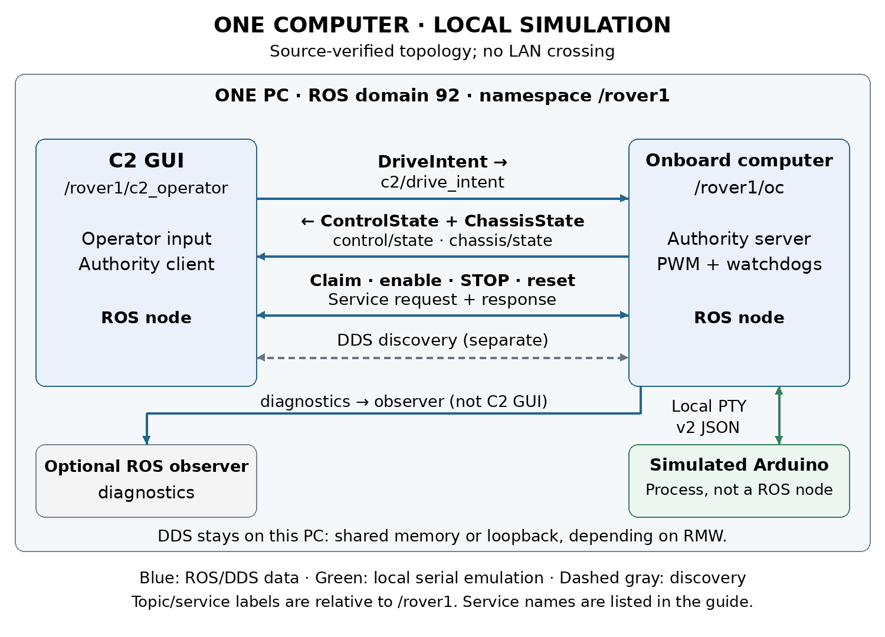
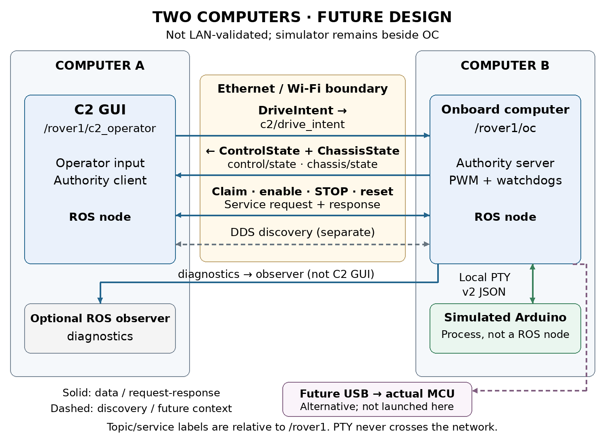

# Distributed computers v1

Run the C2 command-authority prototype on this Linux computer, inspect its ROS 2 interfaces, and repeat controlled simulation experiments. This package uses the existing `~/weeny_ws` installation. C2 and the onboard computer (OC) are separate ROS processes; the simulated Arduino is a separate process on a local pseudo-terminal (PTY). No Arduino or motor power is needed.

Prepared November 3, 2026. Protocol v2 uses OPEN_LOOP_PWM. Throttle and steering are normalized requests, not measured speeds. Software application acknowledgment, simulated encoder feedback, and physical movement are different kinds of evidence. This walkthrough produces simulation evidence only.

## Package contents

Run all commands from `~/weeny_ws` using `./scripts/dcv1`. The documentation and tools now live inside that workspace in `distributed computers v1`. Edit `~/weeny_ws/distributed computers v1/config/settings.yaml`; new logs are stored under `~/weeny_ws/distributed computers v1/evidence`. Paths such as `config/settings.yaml` and `evidence/` elsewhere in these guides refer to that package subfolder. No runtime files are required from Documents/ChatGPT.

`README.docx` has the same instructions as this file. The `docs` folder contains six DOCX references: OC prototype; Command authority and interfaces; Parameters and test scenarios; ROS2 nodes and network communication; Validation and hardware context; Arduino migration test plan. The `maps` folder contains editable SVG and PNG diagrams. Configuration is in `config/settings.yaml`; commands are in `scripts`; results are in `evidence`. Source inventory records identify the source files used to prepare the package.

This folder is documentation and tooling, not a portable application source bundle. Keep the workspace installed at the configured path. The hardware guide is a separate acceptance procedure, not part of the runnable local workflow.

## Prerequisites and build check

Use Linux with ROS 2 Jazzy, the built v2 workspace, Python 3 with PyYAML, the ROS Python dependencies, and Tk for the GUI. The graph command also needs `rqt_graph` and a graphical desktop. Package commands source the ROS environments themselves and use localhost discovery; ordinary `ros2` commands need the terminal setup below.

After source or interface changes, rebuild all participants together:

```bash
cd ~/weeny_ws
./scripts/build.sh
source /opt/ros/jazzy/setup.bash
source ~/weeny_ws/install/setup.bash
ros2 pkg prefix mini_rover_c2
ros2 pkg prefix mini_rover_oc
ros2 interface show mini_rover_interfaces/msg/DriveIntent
```

Inspect that the installed intent has v2 throttle/steering fields. Do not substitute old forward/turn velocity instructions. To run the existing workspace regression suite separately, use `ROS_DOMAIN_ID=97 ./scripts/run_tests.sh` from `~/weeny_ws`. The package authority test below is an additional end-to-end simulation check.

## Environment in every observation terminal

Run these commands in each terminal used for direct ROS inspection or the native C2 CLI. If you change the configured domain, use that value here too.

```bash
source /opt/ros/jazzy/setup.bash
source ~/weeny_ws/install/setup.bash
export ROS_DOMAIN_ID=92
export ROS_AUTOMATIC_DISCOVERY_RANGE=LOCALHOST
unset ROS_STATIC_PEERS
cd ~/weeny_ws
```

All local participants must use the same domain and namespace. A ROS domain is a discovery separation mechanism, not authentication. The package tools set their child environment from YAML and restrict discovery to this computer; the parent shell is not reconfigured by a tool command.

## Start and use the GUI

```bash
./scripts/dcv1 start
./scripts/dcv1 status
```

Defaults are domain 92, namespace `/rover1`, GUI enabled, OC PWM ceiling 63, and simulator response time 0.20 seconds. Startup first verifies a healthy disabled simulated handshake, then applies the configured fault baseline without enabling. Start creates a unique PTY, fault file, run directory, and process ownership records. It refuses a conflicting session in the same domain and namespace; it does not terminate existing work. If a previous workspace demo is running, use its own terminal to stop it or select another domain/namespace for this package.

In the GUI:

1. Click **Connect / claim OC** and wait for a new neutral command acknowledgment and fresh simulated feedback.
2. Set throttle and steering to zero, release the hold control, and click **Enable at neutral**. Wait for MCU-confirmed enable.
3. Enter throttle `0.20` and steering `-0.25`; press and hold **HOLD TO DRIVE**.
4. Release the button to request zero while remaining armed. Leaving the hold button also releases it; losing window focus disarms.
5. **Disarm** disables. **STOP** latches disabled. **Reset STOP** clears the latch while remaining disabled. Re-enable deliberately at neutral before driving again.

A value entered in a field does not latch motion. Positive throttle is forward; positive steering is left/counterclockwise. The OC mixes left = throttle − steering and right = throttle + steering, scales together when needed, then rounds to signed integer PWM. At ceiling 63, the example produces left 28 and right −3. FL/RL share the left output; FR/RR share the right output.

The dashboard separates operator request, OC-limited PWM, and MCU-applied PWM. Enable is only confirmed when fresh MCU feedback supports it. Raw encoder counts have per-channel validity and direction validity; unavailable or stale values are N/A. Synthetic counts are labelled simulated. There is no calibrated speed or tracking error in this milestone. A duty-cycle ceiling of 63/255 does not imply a measured speed limit.

## Send a repeatable command

Use a headless package session for CLI experiments. A connected GUI keeps ownership while it publishes neutral commands; clicking Disarm alone does not release that ownership.

```bash
./scripts/dcv1 stop
./scripts/dcv1 start --headless
./scripts/dcv1 command --throttle 0.20 --steering -0.25 --duration 5
./scripts/dcv1 status
```

The command client requires fresh feedback labelled simulated, claims exclusive authority, enables at neutral, holds the test input, checks correlated applied PWM, releases to zero, and disarms. JSON output records expected/applied PWM and command identities. Another owner causes a clear refusal; the command does not take over. After a client stops publishing, wait for its input lease to expire before claiming from another C2 client.

The equivalent existing workspace CLI syntax is:

```bash
ros2 run mini_rover_c2 c2_cli --simulation \
  --throttle 0.20 --steering -0.25 --duration 5
```

Use `--namespace /another_rover` when appropriate. The old `--forward` and `--turn` flags are invalid. Omitting `--simulation` is also invalid. The native CLI operates through ROS but does not create a package-managed simulation session.

## Edit settings and repeat experiments

Edit `config/settings.yaml`. CLI flags override YAML for that invocation. Throttle and steering must be finite numbers from −1 to 1; duration must be greater than zero and at most 3600 seconds; PWM ceiling must be an integer from 1 to 63; response time must be finite and positive. See the Parameters guide for the complete table and observations.

Workspace, domain, namespace, GUI, PWM ceiling, and simulator response time are launch settings: stop and start to apply changes. Command values are read by each `command` invocation. Fault settings are read at start and by each `fault` invocation. With another domain or namespace, repeat its overrides on every command, or save them in YAML.

```bash
./scripts/dcv1 stop
./scripts/dcv1 start --headless --pwm-limit 31 --response-time 0.5
./scripts/dcv1 command --throttle 0.6 --steering 0.2 --duration 2
```

The OC ceiling is now 31; the simulated MCU's local hard ceiling remains 63. Changing response time changes the simulated response model, not a command watchdog or network delay. Protocol version, publication rates, watchdogs and challenge lifetimes remain fixed.

## Run authority and fault tests

```bash
./scripts/dcv1 test
```

The automated run creates a headless session on domain 97 with a unique namespace, independent of the normal domain 92 session. It reports checks and cleanup evidence in `evidence/tests`. A nonzero exit or `passed: false` is a failed test; read its error and logs before drawing conclusions. Use `--output /absolute/empty/folder` to choose a new result directory. On November 3, 2026, the final package run passed 18 authority checks and 8 desktop/tooling checks; the existing controller and C2 subset passed 91 tests. See `evidence/VALIDATION.md` for exact runs, coverage and limits.

For manual experiments on a running package session:

```bash
./scripts/dcv1 fault --missing rear_right
./scripts/dcv1 fault --delay-ms 400
./scripts/dcv1 fault --drop-commands
./scripts/dcv1 fault --silence
./scripts/dcv1 fault --clear
```

Each invocation replaces active faults with the YAML fault baseline plus that call's flags. It does not accumulate the previous call's flags. `--clear` always writes healthy defaults, regardless of YAML. Use comma-separated `front_left,rear_left,front_right,rear_right` names for missing channels. A missing encoder produces a warning and invalid channel data but permits open-loop drive. Delayed/silent feedback and dropped commands can revoke authority. Clearing faults never re-enables control.

These faults affect the OC↔simulator serial path. They do not simulate DDS network loss between C2 and OC. To test C2→OC freshness, use the GUI's **Pause command publication (watchdog test)** control while holding a simulated command. Input expires after 250 ms and authority is withdrawn. Unpause, return controls to neutral, claim again, and deliberately enable. Do not confuse disarming with stopping publication: disarm withdraws motor permission while fresh neutral input can retain ownership.

MCU drive expiry is separately 250 ms; MCU feedback and C2 state freshness limits are 350 ms; issuer challenges expire after 200 ms. These are software deadlines, not measured physical stopping times. Polling, repeated commands, or unrelated fresh telemetry do not renew valid drive permission. Recovery from timeout, restart, reconnect, or STOP/reset remains disabled.

## Map the nodes and transport



C2 and OC exchange DDS topics and authority services inside this computer. The OC uses bounded JSON lines at 115200 baud over a PTY to the non-ROS simulator. Local DDS may use shared memory depending on middleware settings, or loopback transport. A graph edge proves a ROS connection; it does not prove traffic crossed a network adapter. Optional physical USB is a different deployment, outside this workflow.

```bash
./scripts/dcv1 graph
ros2 node list --no-daemon
ros2 node info /rover1/c2_operator
ros2 node info /rover1/oc
ros2 topic list -t
ros2 topic info /rover1/c2/drive_intent --verbose
ros2 topic echo /rover1/control/state --qos-reliability best_effort
ros2 topic echo /rover1/chassis/state --qos-reliability best_effort
ros2 service list -t
```

In a headless session there is no persistent GUI C2 node; the command client exists only while a command runs. Package observers and graph utilities may add temporary nodes. Topic QoS is best effort, volatile, depth one, with 250 ms lifespan. State publication is 20 Hz; MCU samples are approximately 10 Hz plus operation responses.

If rqt_graph is empty, check terminal domain and discovery settings, refresh after discovery, select **Nodes/Topics (all)**, and use `/rover1/.*` for both filters. `/rover1` alone can hide everything. The graph command applies namespace filters and refreshes periodically. Standard rqt_graph displays topic connections; inspect node/service lists for `control/claim`, `control/set_enabled`, `control/stop`, and `control/reset_stop`. The diagrams include these service connections explicitly.

## Future two computer deployment



This is an unvalidated deployment guide for two physical machines. Place C2 on computer A and OC plus simulator on computer B. C2→OC drive intent, OC→C2 control/chassis state, authority service requests/responses, and discovery cross Ethernet/Wi-Fi. Diagnostics crosses only if an observer on A subscribes. PTY serial stays on B; optional physical USB would also stay on B.

Both computers need compatible built interfaces, the same domain/namespace, middleware configuration and network reachability. Localhost-only discovery must be replaced deliberately; the future network guide explains SUBNET discovery and optional static peers. Existing workspace demo launchers and this package's local wrapper force localhost, so do not use them unchanged for a distributed test. Two-machine discovery, transport, latency, firewall behavior, and failure recovery have not been validated by this package's local tests.

## Logs and shutdown

Each session records `launch_spec.json`, `faults.json`, process output logs and OC JSONL runs under `evidence/runs/<session-id>`. Command clients add correlated state logs and a command result. Automated runs use `evidence/tests/<run-id>` with `result.json` and cleanup records. These records distinguish requested, accepted and applied identities; recent OC state does not make an old sensor sample fresh.

```bash
./scripts/dcv1 stop
./scripts/dcv1 status
```

Stop targets only matching processes in this package's session records, checking process identity before signaling. It does not stop another launcher, another domain/namespace, or unrelated applications. Keep logs when investigating a failure. If a process exited unexpectedly, inspect logs and run stop to clear that owned session before starting again. Hardware flashing, motor power, and powered motion are outside these commands.
