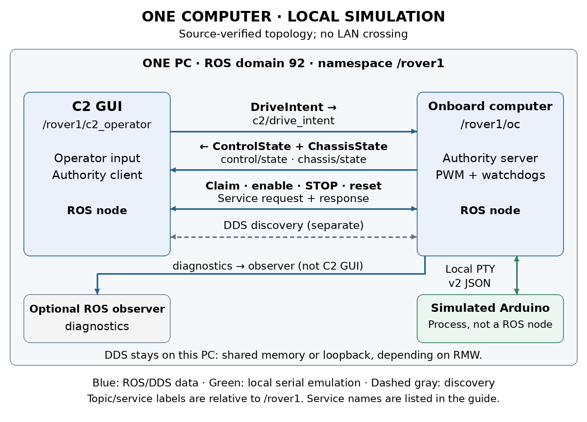
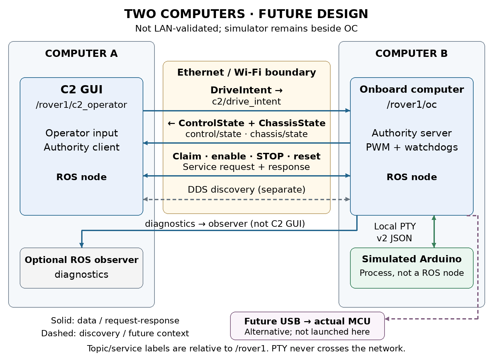

# ROS2 nodes and network communication

This guide maps the current local simulation and describes a future split between two Linux computers. The local route has two application ROS nodes and one non-ROS simulator process. The two-computer commands below are a source-reviewed deployment guide, not a completed test on two physical machines. Protocol v2 and the fixed authority deadlines remain unchanged in either placement.

## Current local placement



C2 runs the operator GUI in `/rover1/c2_operator`. It publishes normalized input and calls the OC authority services. `/rover1/oc` checks exclusive ownership, identities, generations and freshness, limits the paired side PWM, and exchanges v2 JSON with the simulated Arduino. Both ROS nodes run on this computer in domain 92 by default.

The simulated Arduino is a separate Python process. It creates a Linux pseudo-terminal, or PTY, and a session-specific symlink. OC opens that PTY as its serial endpoint. The simulator receives commands, maintains its independent watchdog and produces explicitly simulated feedback. It has no ROS node name, topic or service. Its absence from `ros2 node list` is expected.

Local C2-to-OC traffic uses ROS middleware and DDS. Depending on the middleware and configuration, local delivery can use shared memory or a local network transport. A drawn graph edge proves a discovered publisher/subscriber relationship; it does not prove that packets crossed Ethernet or Wi-Fi. The PTY path is local kernel communication and never crosses a physical network.

## Interfaces and transport boundaries

| Interface under /rover1 | Direction | Local or future transport |
|---|---|---|
| c2/drive_intent | C2 to OC | Local DDS now; network DDS when split |
| control/state | OC to C2 | Authority and confirmation over DDS |
| chassis/state | OC to C2 | MCU samples and provenance over DDS |
| diagnostics | OC to optional observer | DDS; crosses network if observer is remote |
| control/claim | Request and response | C2 client to OC server over ROS service transport |
| control/set_enabled | Request and response | Enable or disarm operation |
| control/stop and control/reset_stop | Request and response | STOP latch and disabled reset |
| PTY serial | OC to simulator and back | Local bounded JSON lines at configured 115200 baud |
| Physical USB serial | OC to actual MCU and back | Future alternative to PTY; excluded from this package workflow |

The diagram includes service connections because claim, enable, disarm, STOP and reset are essential to command authority. Standard `rqt_graph` draws topic connections, so its topic view is not the complete authority map. Service acceptance also does not by itself prove that the MCU applied an operation; C2 checks subsequent correlated confirmation.

Topic QoS is best effort, volatile, depth one, with 250 ms lifespan. C2 input and OC state run at 20 Hz; MCU telemetry is approximately 10 Hz plus operation responses. Services use ROS service QoS rather than the topic profile. Inspect the actual endpoints instead of assuming that a CLI subscriber uses compatible settings.

## Inspect the local graph

In every observation terminal, source the workspace and select the running session domain. If settings use another namespace or domain, replace both consistently.

```bash
source /opt/ros/jazzy/setup.bash
source ~/weeny_ws/install/setup.bash
export ROS_DOMAIN_ID=92
export ROS_AUTOMATIC_DISCOVERY_RANGE=LOCALHOST
unset ROS_STATIC_PEERS
ros2 node list --no-daemon
ros2 node info /rover1/c2_operator
ros2 node info /rover1/oc
ros2 topic list -t
ros2 service list -t
ros2 topic info /rover1/c2/drive_intent --verbose
ros2 topic info /rover1/control/state --verbose
```

The C2 node exists only while the GUI or command client is running. A headless session with no command client normally shows OC alone, plus temporary observers. Package command/test clients may use unique node names. ROS infrastructure such as `/rosout` and parameter services can also appear.

```bash
ros2 topic echo /rover1/control/state --qos-reliability best_effort
ros2 topic echo /rover1/chassis/state --qos-reliability best_effort
ros2 topic hz /rover1/chassis/state
ros2 interface show mini_rover_interfaces/msg/DriveIntent
ros2 interface show mini_rover_interfaces/srv/Control
```

Use `./scripts/dcv1 graph` from the package folder for its managed graph window. In a manually opened rqt_graph, choose Nodes/Topics all, use `/rover1/.*` for both node and topic filters, and refresh. The filter `/rover1` alone can match an exact name and hide every child endpoint. Hidden/dead-end filters can also remove useful elements. Inspect service list and node info for authority services.

## Future two computer placement



Computer A hosts C2. Computer B hosts OC and the simulator; the PTY stays on B. C2 input, OC state, chassis samples and authority service requests/responses cross Ethernet or Wi-Fi. DDS discovery also crosses that boundary. Diagnostics crosses only when an observer on A subscribes. Optional physical USB would connect MCU to B in a separate hardware workflow.

Install ROS 2 Jazzy and build the same current v2 interface packages on both computers. Use the same domain and namespace, compatible middleware and matching message definitions. Keep `use_sim_time` false. These clocks measure local monotonic leases; matching wall clocks does not lengthen any lease. The 200 ms challenges, 250 ms input/drive deadlines and 350 ms feedback/state deadlines can expose network latency or loss. Do not tune them away for this milestone.

For DDS middleware supporting these ROS discovery variables, configure every relevant terminal on both computers as follows. Replace the workspace path if needed.

```bash
source /opt/ros/jazzy/setup.bash
source ~/weeny_ws/install/setup.bash
export ROS_DOMAIN_ID=92
export ROS_AUTOMATIC_DISCOVERY_RANGE=SUBNET
unset ROS_STATIC_PEERS
```

`SUBNET` permits discovery of nodes reachable by multicast. A common trusted LAN is the simplest starting point; Wi-Fi client isolation, VPN routes, firewall policy and interface selection can prevent discovery or data transfer. If using explicit peer discovery, set the other computer's actual reachable address on each side; for example, on A set `ROS_STATIC_PEERS='192.168.1.20'`, and on B set `ROS_STATIC_PEERS='192.168.1.10'`. These are example addresses. Multiple addresses are separated by semicolons. Static peers do not repair blocked data transport or incompatible middleware configuration. These settings are not supported by rmw_zenoh.

Do not use `scripts/run_demo.sh`, `demo.launch.py`, or this package's `dcv1 start` unchanged for the distributed experiment. They deliberately force local discovery. Launch the participants directly instead. Check for existing sessions before using the example PTY path below, and use an unused namespace/domain if another route is active.

On computer B, Terminal B1, after the common environment setup:

```bash
ros2 run mini_rover_sim arduino_sim \
  --port-link /tmp/dcv1-network-arduino \
  --fault-file /tmp/dcv1-network-faults.json \
  --response-time 0.20 --pwm-limit 63
```

On B, Terminal B2, repeat the common environment setup, wait for the PTY link, then run:

```bash
ros2 run mini_rover_oc oc --ros-args \
  -r __ns:=/rover1 \
  -p port:=/tmp/dcv1-network-arduino \
  -p baud:=115200 -p simulated:=true -p pwm_limit:=63
```

On computer A, after the common environment setup:

```bash
ros2 run mini_rover_c2 c2_gui --namespace /rover1
```

First confirm fresh simulated chassis feedback with disabled outputs. Claim, enable at neutral with hold released, then perform the same hold/release and STOP/reset observations as the local walkthrough. Shut down each foreground process with Ctrl+C; do not start package cleanup against these manually launched processes. Save logs on both computers and correlate source identities, not wall-clock equality alone.

To demonstrate actual network transfer, inspect or capture the selected NIC's traffic while exercising the route and correlate it with the command logs. Merely seeing both nodes in rqt_graph or discovering services does not demonstrate transport timing, packet delivery or the actual interface used. No such two-host capture is included in this package's acceptance evidence.

## Fault placement and troubleshooting

Package delay, silence and command-drop faults affect the OC-to-simulated-MCU serial path on the same computer. Missing encoders change the simulator's measurement availability. They do not inject Ethernet loss or delay between C2 and OC. Pausing C2 publication tests the C2 input lease. Terminating a process tests that process boundary, not a controlled network impairment.

For an empty graph, check domain, namespace, shell setup, filters and refresh before restarting anything. Use `--no-daemon` when listing nodes to avoid relying on a daemon started under an older environment. For visible nodes but no data, inspect endpoint QoS and exact types. For fresh OC state but stale chassis data, inspect serial-path faults and the separate MCU sample age. For a rejected command, inspect current owner, STOP latch, neutral readiness and freshness; graph visibility alone grants no authority.

## Sources

Project sources: `~/weeny_ws/OC_PROTOTYPE.md`, `INTERFACE_V2.md`, `src/mini_rover_oc/mini_rover_oc/node.py`, `src/mini_rover_c2/mini_rover_c2/ros_client.py`, `src/mini_rover_sim/mini_rover_sim/simulator.py`, `scripts/run_demo.sh` and `src/mini_rover_oc/launch/demo.launch.py`. Exact paths, hashes and timestamps are recorded in `evidence/source_inventory.json`.

ROS 2 Jazzy discovery reference: https://raw.githubusercontent.com/ros2/ros2_documentation/jazzy/source/Tutorials/Advanced/Improved-Dynamic-Discovery.rst

Fast DDS shared memory reference: https://fast-dds.docs.eprosima.com/en/latest/fastdds/transport/shared_memory/shared_memory.html

Reviewed 3 November 2026. The future placement is an inference from current process boundaries and documented discovery behavior; two-machine operation remains unvalidated.
