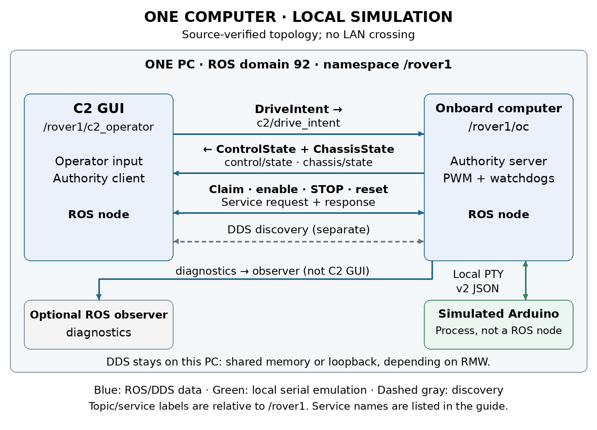
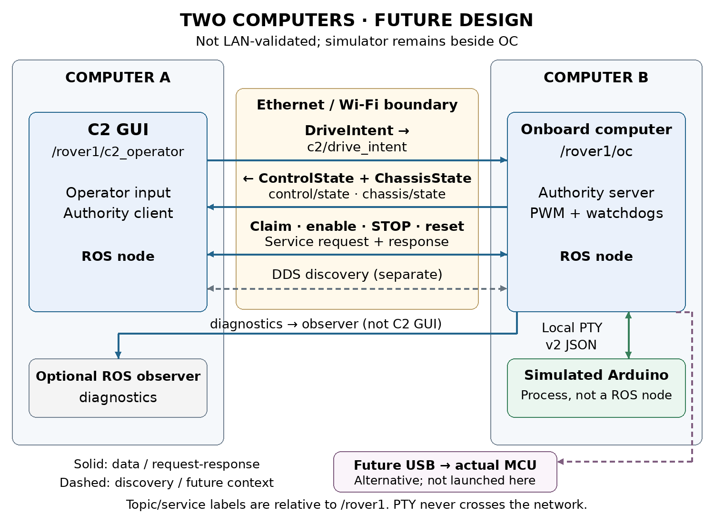

# OC prototype operating guide

Use this guide to operate the current protocol v2 prototype between C2, the onboard computer (OC), and a simulated Arduino on one Linux computer. The OC validates authority and freshness, converts normalized intent to paired side PWM, and reports what the MCU simulator confirmed. The local workflow uses no physical Arduino. Prepared November 3, 2026.

## Run the packaged local session

The existing v2 workspace must be built at `~/weeny_ws`, or at the path in `config/settings.yaml`. Build after interface/source changes with `~/weeny_ws/scripts/build.sh`. Package-local tools source ROS Jazzy and the workspace automatically. Run from the workspace root:

```bash
cd ~/weeny_ws
./scripts/dcv1 start
./scripts/dcv1 status
```

The default session is domain 92, namespace `/rover1`, GUI enabled, a new local PTY, ceiling 63 and response time 0.20 seconds. Conflicting sessions are refused. The tool never substitutes a physical serial device for its own PTY. `./scripts/dcv1 stop` stops only that package-owned session.

For each terminal using ordinary ROS commands, prepare the environment explicitly:

```bash
source /opt/ros/jazzy/setup.bash
source ~/weeny_ws/install/setup.bash
export ROS_DOMAIN_ID=92
export ROS_AUTOMATIC_DISCOVERY_RANGE=LOCALHOST
unset ROS_STATIC_PEERS
```

## Use the GUI authority controls

**Connect / claim OC** requests exclusive ownership. Wait for fresh state and acknowledgment of new neutral input after the claim. Enable is unavailable until that barrier is satisfied. Set both fields to zero, release hold, and select **Enable at neutral**. An accepted OC service response is not sufficient evidence that the MCU enabled; wait for the separate confirmed state.

Enter finite throttle and steering fractions in `[-1, 1]`, then hold **HOLD TO DRIVE**. Positive throttle requests forward; positive steering requests left/counterclockwise. Releasing hold requests zero while armed. Moving outside the hold control releases it. Focus loss disarms. Field edits are a selection of the next held input, not a latched drive command.

**Disarm** withdraws motor permission. **STOP** latches a stop condition and withdraws ownership/authority as required by the contract. **Reset STOP** clears the latch while remaining disabled. A deliberate enable at neutral is required after reset or recovery. Do not infer motor permission from an earlier enabled display after state becomes stale.

## Interpret requests and feedback

| Display or field | Meaning |
|---|---|
| Operator throttle and steering | Selected normalized intent; neither m/s nor rad/s |
| OC-limited left/right PWM | Mixed, ratio-scaled and rounded command after the configured OC ceiling |
| MCU-applied left/right PWM | Output state confirmed by fresh MCU feedback, with checked identity |
| OC authorization | OC permission to forward valid drive input |
| MCU-confirmed enable | Actual enable reported by the MCU; may be unknown or stale |
| Encoder validity and direction validity | Separate flags for each named raw count; N/A when unavailable |
| Simulation provenance | Indicates model output and synthetic counts, not physical measurement |

The OC mixes left = throttle − steering, right = throttle + steering, scales both together if either exceeds unit magnitude, multiplies by its ceiling, and rounds symmetrically. At ceiling 63, throttle 0.20 and steering −0.25 produce left 28, right −3. FL and RL share left; FR and RR share right. PWM is signed duty-cycle demand with a hard MCU ceiling of ±63 out of 255. It is not a measured speed ceiling.

Raw encoder availability is truthful per channel. Missing encoders warn but do not block OPEN_LOOP_PWM. A fresh OC state does not refresh an old MCU sensor sample. This milestone does not display calibrated speed or speed-tracking error. MCU software acknowledgment establishes output-state application; physical movement remains separate evidence.

## Run a headless command

A GUI that has claimed ownership continues publishing fresh neutral input even when disarmed. For repeatable CLI runs, use a headless session instead of competing with it:

```bash
./scripts/dcv1 stop
./scripts/dcv1 start --headless
./scripts/dcv1 command --throttle 0.20 --steering -0.25 --duration 5
```

The package client requires fresh simulated feedback, claims, enables at neutral, holds input, checks correlated applied PWM, releases and disarms. A competing owner is reported and remains undisturbed. After a client ends publication, its ownership lease must expire before another C2 can claim.

The installed workspace CLI can also use the running simulator after the terminal environment is prepared:

```bash
ros2 run mini_rover_c2 c2_cli --simulation \
  --throttle 0.20 --steering -0.25 --duration 5
```

`--simulation` is required. `--forward` and `--turn` are obsolete velocity-mode options and are rejected. Use `--namespace /another_rover` for another namespace. The package `command` reads command defaults from YAML; the native ROS CLI uses its own argument defaults.

## Authority and freshness behavior

C2 has a process identity and increasing command IDs. The OC accepts one owner, issues a generation and short-lived challenges, and requires newer valid input. Duplicate, malformed, old-generation and expired-challenge input does not renew permission. These replay/freshness controls are not cryptographic authentication.

| Fixed timing | Limit or rate |
|---|---|
| C2 input / MCU drive expiry | 250 ms independently |
| MCU feedback / C2 state expiry | 350 ms independently |
| Issuer challenge/sample-token lifetime | 200 ms |
| Enable/reset confirmation deadline | 350 ms; one transmission attempt |
| Input and OC state publication | 20 Hz |
| MCU telemetry | Approximately 10 Hz plus operation responses |

Polling, unrelated telemetry and repeated IDs cannot extend drive authority. Enable/reset failure cancels pending permission; another deliberate operator action is required. STOP/disarm preempt pending operations. Restart, timeout, reconnect and STOP reset remain disabled. Do not compare clocks across processes as though they were one monotonic clock; the issuing component evaluates its own freshness deadlines.

In the GUI, **Pause command publication (watchdog test)** stops C2 input renewal. Confirm authority expires, rather than treating Disarm as a publication test. Unpause, return to neutral, reclaim and enable deliberately. First-fault evidence remains available after recovery.

## Understand the process boundary



C2 and OC are ROS nodes. The Arduino simulator is a non-ROS process on a Linux PTY. ROS topic/service traffic is local DDS; depending on middleware configuration it may use shared memory or loopback. The diagram's service edges are explanatory: standard rqt_graph shows topic edges, not the complete authority service exchange.

Under `/rover1`, `c2/drive_intent` carries C2→OC input. OC→C2 `control/state` reports authority, identities, limiting and faults; `chassis/state` carries MCU sample identity, PWM and raw encoder validity. `diagnostics` serves observers. C2 uses `control/claim`, `control/set_enabled`, `control/stop`, and `control/reset_stop` services. Topic QoS is best effort, volatile, depth one, lifespan 250 ms.

```bash
./scripts/dcv1 graph
ros2 node info /rover1/oc
ros2 service list -t
ros2 topic info /rover1/c2/drive_intent --verbose
```

Use `/rover1/.*` filters and **Nodes/Topics (all)** in rqt_graph. Empty output usually calls for checking domain, namespace, discovery and graph filters before changing the application.

## Future placement on two computers



Place C2 on A and OC plus simulator on B. DDS discovery, drive intent, returning state and authority service requests/responses cross the network. PTY serial remains local to B. Optional physical USB remains a separate B-side hardware boundary. Diagnostics crosses only when a remote observer subscribes.

This placement is not validated on two physical machines. Localhost-only wrappers cannot be used unchanged; see the network guide for explicit discovery and direct process placement. A graph edge alone does not establish that packets crossed Ethernet/Wi-Fi.

## Fault experiments and records

`./scripts/dcv1 test` runs isolated headless authority checks, default domain 97. Manual `fault` commands alter the simulator serial path: `--delay-ms 400`, `--drop-commands`, `--silence`, or `--missing rear_right`. Each call resolves the YAML fault baseline plus that call's flags, replacing the previous active selection. The clear option writes healthy defaults. Clearing never restores enable automatically.

Session artifacts live in `evidence/runs/<id>`; automated results in `evidence/tests/<id>`. Keep the launch settings, OC logs, client state logs, command identities and cleanup record together when interpreting a run. The Validation and hardware context guide separates dated software, unpowered-board and still-pending physical tests.
